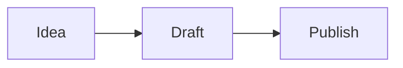

# Agent Slide Decks

A deck is a *narrative with layout*, not a set of bullet points. The tooling
differs, the discipline is the same: one idea per slide, a visible hierarchy,
and a title that makes a claim rather than naming a topic.

## Choosing a tool

| Tool | Output | Best for |
|---|---|---|
| **Marp** | HTML/PDF/PPTX | Markdown → slides in minutes. Best default. |
| **Slidev** | Web app, PDF, PPTX | Code-heavy decks, Vue components, live animations |
| **reveal.js** | Web | Embedding in a site, custom themes |
| **python-pptx** | PPTX | Editing existing corporate templates |
| **Remotion** | Video | When the "deck" is really a video (see `remotion-best-practices`) |

**If you must produce a .pptx a colleague will edit, use `python-pptx`.** If the
deck just has to look good and be shared as a link or PDF, use Marp.

## Marp — markdown to slides

```bash
npm install -g @marp-team/marp-cli
```

```markdown
---
marp: true
theme: default
paginate: true
size: 16:9
style: |
  section { font-size: 32px; }
  h1 { color: #f43f5e; }
  section.lead h1 { font-size: 56px; }
---

<!-- _class: lead -->
# Slide decks that read themselves

A deck is a narrative with layout.

---

## One idea per slide

- The title is a claim, not a label
- Body supports the claim
- Nothing else

---

<!-- _class: -->
## Images


```

```bash
marp deck.md -o deck.html      # self-contained HTML
marp deck.md -o deck.pdf       # PDF (uses a headless browser)
marp deck.md -o deck.pptx      # one slide per PPTX page
marp --watch deck.md           # live reload
```

Key frontmatter:

| Key | Purpose |
|---|---|
| `theme` | built-in (`default`, `gaia`, `uncover`) or a custom CSS file |
| `size` | `16:9` or `4:3` |
| `paginate` | page numbers |
| `style` | raw CSS scoped to the deck |
| `header` / `footer` | repeated text on every slide |
| `class: lead` | a per-slide class for special layouts |

Per-slide directives:

```markdown
<!-- _class: lead -->
<!-- _backgroundColor: #111 -->
<!-- _paginate: false -->
```

`style:` with raw CSS is where a Marp deck stops looking like everyone else's.

## Slidev — code-driven decks

```bash
npm init slidev@latest
```

```vue
---
theme: seriph
title: Code-driven slides
---

# Code-driven slides

<style>
h1 { color: #42b883; }
</style>

---

## Code highlighting

```js
const deck = await render({ fps: 30 })
```

---
layout: two-cols
---

::left::

Left column

::right::

Right column
```

Slidev gives you Vue components, layouts, an in-browser presenter mode, and
`slidev export` to PDF/PPTX. It also has a **play mode** for recording the talk
as video.

Custom layouts live in `layouts/` — a Vue file with slots.

## python-pptx — editing real templates

```bash
pip install python-pptx
```

```python
from pptx import Presentation
from pptx.util import Inches, Pt
from pptx.dml.color import RGBColor

prs = Presentation("template.pptx")          # start from the corporate template
slide = prs.slides.add_slide(prs.slide_layouts[1])

slide.shapes.title.text = "Revenue grew 3× without new headcount"

body = slide.placeholders[1].text_frame
body.text = "Self-serve onboarding"
for i, line in enumerate(["Reduced time-to-value", "Cut support tickets 40%"]):
    p = body.add_paragraph() if i else body.paragraphs[0]
    p.text = line
    p.font.size = Pt(18)

prs.save("out.pptx")
```

**Start from the real template.** `Presentation()` with no argument gives you
the default Office theme, which is why python-pptx decks look generic. Load the
company `.pptx`, then use `slide_layouts` for structure.

Layout indices in a default deck:

| Index | Layout |
|---|---|
| 0 | Title slide |
| 1 | Title and content |
| 2 | Section header |
| 3 | Two content |
| 4 | Comparison |
| 5 | Title only |
| 6 | Blank |

## Speaker notes

Every format supports them, and they change the deck from a document into a
talk.

```python
slide.notes_slide.notes_text_frame.text = (
    "Pause here. The key point is that onboarding is now self-serve — "
    "ask if anyone has tried it."
)
```

In Marp, notes live in an HTML comment at the end of the slide:

```markdown
<!--
Speaker notes: pause here, ask if anyone has tried it.
-->
```

## Images

```bash
# download a photo for the deck
curl -L "https://images.pexels.com/photos/1181671/pexels-photo-1181671.jpeg" -o hero.jpg
```

```markdown

```

Marp's background syntax lets you place images as full-bleed or half-slide:

```markdown


```

In python-pptx:

```python
slide.shapes.add_picture("hero.jpg", Inches(5.5), Inches(1), width=Inches(4))
```

## Charts

Mermaid is available in Marp via a fenced block:

````markdown

````

```bash
npm install -g @mermaid-js/mermaid-cli
mmdc -i chart.mmd -o chart.png -t dark -b transparent
```

For real data, plot with matplotlib or Plotly and drop in the PNG/SVG:

```python
import matplotlib.pyplot as plt
plt.figure(figsize=(10, 5.6), dpi=200)   # 16:9 at 200dpi
plt.plot(months, revenue, linewidth=3)
plt.tight_layout()
plt.savefig("chart.png", transparent=True)
```

`dpi=200` matters — a 96dpi chart stretched across a projector looks soft.

## Export to PDF

```bash
marp deck.md --pdf --pdf-outlines --pdf-notes
```

`--pdf-notes` appends the speaker notes as PDF pages. `--pdf-outlines` adds
bookmarks for navigation.

## Video from a deck

Slidev:

```bash
slidev export --format mp4 --with-clicks deck.md
```

Remotion (best quality, render farm friendly):

```bash
npx remotion render Deck out/video.mp4
```

See `remotion-best-practices`.

## Deck quality rules

| Rule | Why |
|---|---|
| Title states the claim | "Revenue grew 3×" beats "Revenue" |
| One idea per slide | Two ideas means zero are remembered |
| ≤ 6 lines of text, ≤ 6 words per line | Audience reads faster than you talk |
| 32pt+ body text | Small text is unreadable from the back |
| Contrast ≥ 4.5:1 | Projectors wash out low contrast |
| Never place text over a busy image | Add a gradient scrim or a solid panel |
| Consistent margins | Same left edge on every slide |
| Read the deck aloud | If it sounds wrong written, it is wrong |

## Common failures

**The PDF has the wrong fonts** — Marp's PDF export uses a headless Chromium;
fonts not installed on the machine are substituted. Install them or embed them
in the theme.

**PPTX text overflows the placeholder** — python-pptx does not auto-shrink.
Set `tf.word_wrap = True` and reduce the font size, or size your content to fit.

**Charts look blurry in the PDF** — rendered at too low a DPI. Render at 200+ DPI
or as SVG (Marp supports SVG backgrounds).

**Speaker notes missing from the exported file** — `python-pptx` writes them,
but some converters drop them. Verify by reopening the file.

**The deck is 40 slides** — it is a document, not a talk. A talk is 10–15
slides. Move detail to a handout or an appendix.

**Marp PDF export fails** — the headless browser is missing. Marp bundles
Chromium; on some systems install `chromium` or set `CHROME_PATH`.

**Slidev exports a blank page** — an unclosed code fence. Check the markdown
for unbalanced ```` ``` ````.

## Reference tools

Other open-source design tools worth knowing, each over 1,000
GitHub stars — see `references/design-reference-tools.md`.

## Related skills

`diagram-generation` · `frontend-slides` · `google-slides` ·
`remotion-best-practices` · `reports-pdfs-and-slide-automation` ·
`thumbnail-generator`
