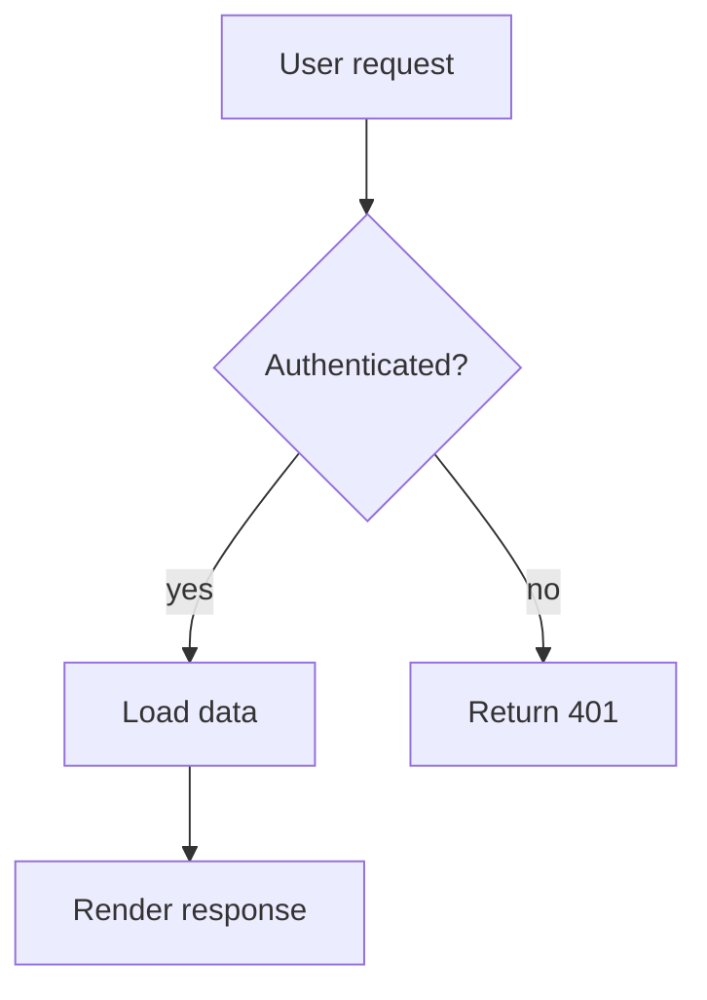
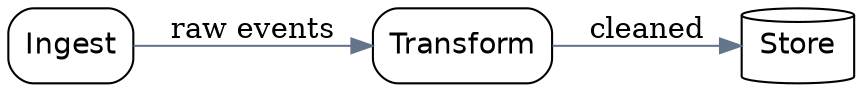
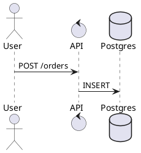

# Diagram Generation

Diagrams are generated text. That is the whole trick: the source is reviewable,
diffable, and regenerable — you fix the text, not the pixels.

## Tool comparison

| Tool | Best for | Output |
|---|---|---|
| **Mermaid** | Flowcharts, sequence, gantt, ER — in docs | SVG/PNG/markdown |
| **Graphviz** | Large auto-laid-out graphs | SVG/PNG/PDF |
| **D2** | Modern declarative layouts, icons | SVG/PNG |
| **PlantUML** | UML, sequence, component diagrams | SVG/PNG |
| **Excalidraw** | Hand-drawn look, whiteboards | PNG/SVG |

**Default to Mermaid** — it lives in the markdown, so the diagram is versioned
with the code that describes it.

## Mermaid

```bash
npm install -g @mermaid-js/mermaid-cli
mmdc -i diagram.mmd -o diagram.png -t dark -b transparent -w 1600
```

Also available as a GitHub-flavoured fenced block in any `.md`:

````markdown

````

### Flowchart

```
flowchart LR
  S((Start)) --> P[Parse input]
  P --> Q{Valid?}
  Q -->|no| E([Error])
  Q -->|yes| R[Transform]
  R --> S2((End))
```

Direction: `TD` (top-down), `LR` (left-right), `RL`, `BT`.

### Sequence diagram

```
sequenceDiagram
  autonumber
  participant U as User
  participant A as API
  participant DB as Database
  U->>A: POST /orders
  A->>A: Validate token
  A->>DB: INSERT order
  DB-->>A: order_id
  A-->>U: 201 Created
```

Solid arrow `->>` is a call; dashed `-->>` is a return. `autonumber` numbers
the steps — essential for explaining a protocol.

### State diagram

```
stateDiagram-v2
  [*] --> Draft
  Draft --> Review: submit
  Review --> Draft: request changes
  Review --> Published: approve
  Published --> Archived: unpublish
```

### Entity relationship diagram

```
erDiagram
  CUSTOMER ||--o{ ORDER : places
  ORDER ||--|{ LINE_ITEM : contains
  PRODUCT ||--o{ LINE_ITEM : "referenced by"
  CUSTOMER {
    string id PK
    string email
    string name
  }
  ORDER {
    string id PK
    string customer_id FK
    decimal total
  }
```

### Styling

```
flowchart TD
  A[Start] --> B[End]
  classDef primary fill:#3b82f6,stroke:#1d4ed8,color:#fff
  classDef warn fill:#f59e0b,stroke:#b45309,color:#fff
  class A primary
  class B warn
```

| Element | Syntax |
|---|---|
| Rounded node | `A([text])` |
| Subroutine | `A[[text]]` |
| Database | `A[(text)]` |
| Diamond | `A{text}` |
| Hexagon | `A{{text}}` |
| Asymmetric | `A>text]` |
| Dotted link | `A -.-> B` |
| With label | `A -->|label| B` |

### Diagrams in code

```python
import subprocess, tempfile, os

MERMAID = """
flowchart TD
  A[Input] --> B[Model] --> C[Output]
"""

with tempfile.NamedTemporaryFile("w", suffix=".mmd", delete=False) as f:
    f.write(MERMAID)
    src = f.name
subprocess.run(["mmdc", "-i", src, "-o", "diagram.svg", "-b", "transparent"],
               check=True)
os.unlink(src)
```

For GitHub-flavoured markdown, `mermaid.ink` renders server-side:

```
https://mermaid.ink/img/pako:<base64-of-encoded-diagram>
```

That is the simplest way to put a diagram in a README with no build step.

## Graphviz

```bash
sudo apt install graphviz
dot -Tsvg pipeline.dot -o pipeline.svg
```



`rankdir=LR` gives left-to-right. `shape=cylinder` is the database node.
`{rank=same; a; b;}` forces nodes onto the same row — this is how you stop
Graphviz from making a diagram that sprawls.

For **large graphs**, use `sfdp` or `circo` instead of `dot`; `dot` is
hierarchical and gets slow past ~50 nodes.

## D2

```bash
curl -fsSL https://d2lang.com/install.sh | sh
d2 architecture.d2 architecture.svg
```

```d2
direction: right

client: Client {
  shape: rectangle
}

api: API Server {
  style.fill: "#eff6ff"
}

db: (Postgres) Database

client -> api: HTTPS
api -> db: SQL
```

D2 has a cleaner syntax than Mermaid and better layout control, including
`direction` inside a block. It also does **icon embedding** from a shape
library, which makes system diagrams look professional.

## PlantUML

```bash
# JAR, or via plantuml.com
java -jar plantuml.jar architecture.puml
```



PlantUML is the strongest for true UML — class, component, deployment,
state — and for **sequence diagrams with alt/loop/else** blocks.

## Excalidraw — the hand-drawn look

```bash
npm install -g @excalidraw/excalidraw
# or use the MCP server: mcp-for-blender style diagram servers exist for Excalidraw
```

Excalidraw's `.excalidraw` file is JSON. A minimal sketch:

```json
{
  "type": "excalidraw",
  "version": 2,
  "source": "https://excalidraw.com",
  "elements": [
    {
      "id": "box1", "type": "rectangle",
      "x": 100, "y": 100, "width": 200, "height": 80,
      "strokeColor": "#1e1e1e", "backgroundColor": "#a0c4ff",
      "fillStyle": "solid", "strokeWidth": 2, "roughness": 1,
      "opacity": 100, "angle": 0,
      "text": "Client", "fontSize": 20, "fontFamily": 1,
      "textAlign": "center", "verticalAlign": "middle"
    }
  ],
  "appState": { "viewBackgroundColor": "#ffffff" }
}
```

Roughness `1` is what gives the hand-drawn look; set it to `0` for clean lines.

The **mermaid → Excalidraw** path exists: `mmdc` can output an `.excalidraw`
file, so you can sketch a diagram in text and then hand-adjust it.

## Choosing the right diagram type

| Question | Diagram |
|---|---|
| What happens step by step? | Flowchart |
| Who talks to whom, in what order? | Sequence |
| What can a thing be in? | State machine |
| How do the tables relate? | ERD |
| How is the system laid out? | Component / C4 |
| What is the timeline? | Gantt |
| What is the mental model? | Concept map (freeform) |

## Common failures

**Mermaid syntax error** — check the arrow direction. `A --> B` is a link;
`A -- text --> B` is a link with a label. Labels with parentheses must be
quoted: `A["text (with parens)"]`.

**The diagram is unreadably large** — Mermaid auto-layout gets wide. Split it,
or use `flowchart TD` for tall content instead of `LR`.

**Text in the SVG is not selectable / fonts differ** — set `htmlLabels: false`
in the Mermaid config, or embed fonts.

**mmdc fails with a Chromium error** — the headless browser needs sandbox
flags: `mmdc -p puppeteer-config.json` with
`{"args": ["--no-sandbox", "--disable-setuid-sandbox"]}`.

**Graphviz output overlaps** — use `splines=ortho` and increase `nodesep` /
`ranksep`.

**D2 layout looks wrong** — `direction: right` inside a block constrains only
that block; move it to the top level for the whole diagram.

**The PNG has a black background** — pass `-b transparent` and composite onto
your background, or export SVG and let the renderer handle it.

**Diagrams are unreadable in a dark-mode site** — hardcoded fills do not
adapt. Use `prefers-color-scheme` CSS in the SVG, or use transparent
backgrounds with `currentColor` text.

## Reference tools

Other open-source design tools worth knowing, each over 1,000
GitHub stars — see `references/design-reference-tools.md`.

## Related skills

`node-link-and-diagram-layout` · `agent-slide-decks` · `frontend-slides` ·
`thumbnail-generator` · `uml-and-software-architecture-visualization`
