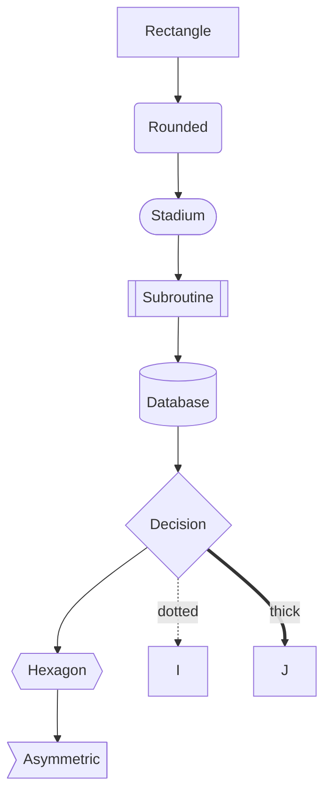
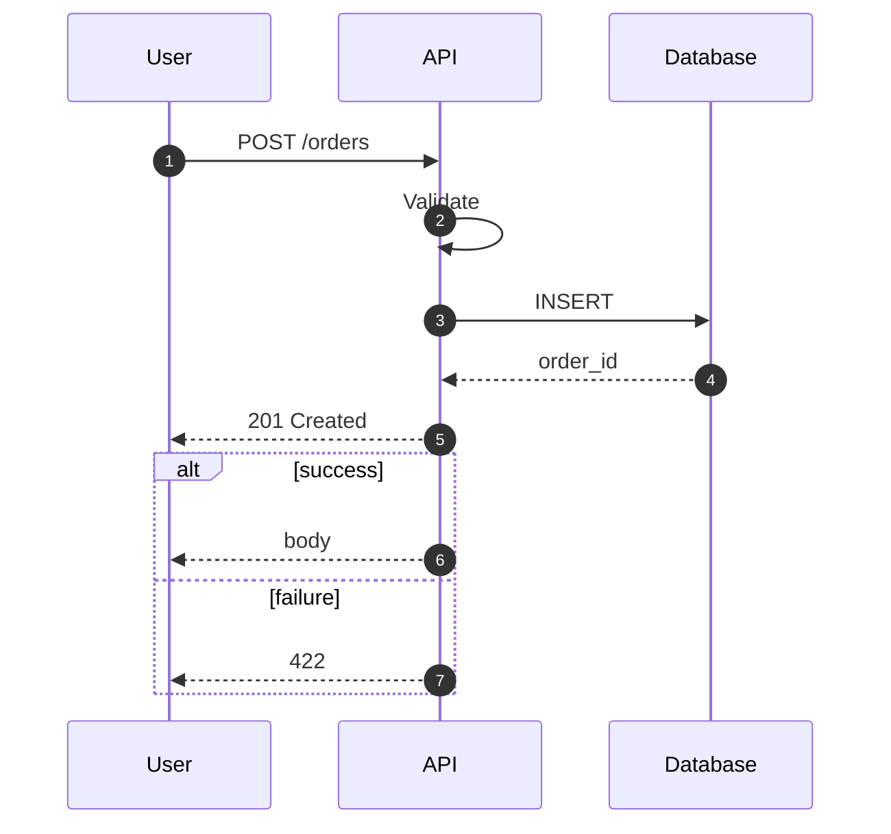
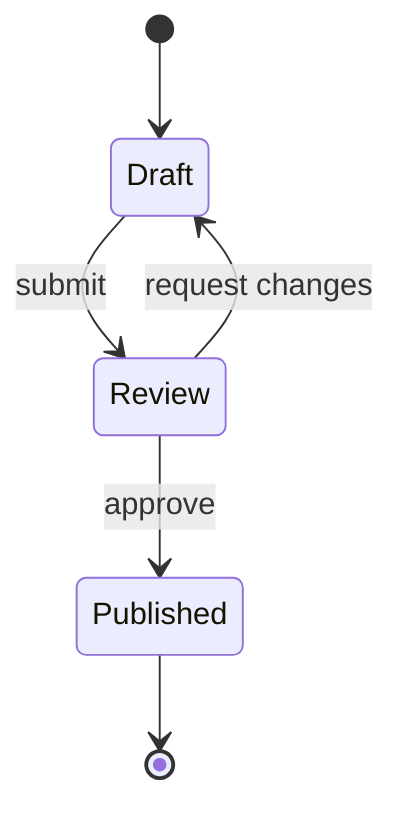
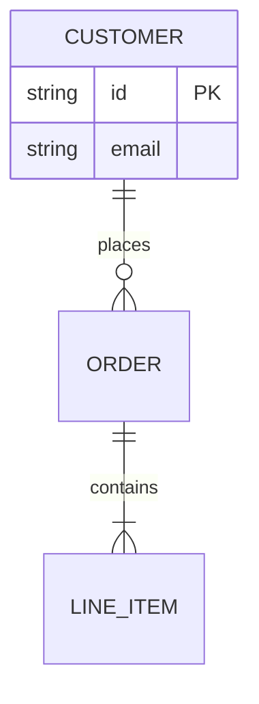
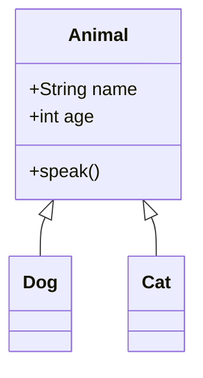
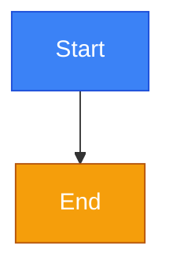
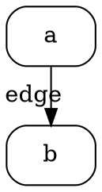

# Mermaid syntax reference

## Flowchart

Directions: `TD`, `LR`, `RL`, `BT`.

## Sequence

`->>` call, `-->>` return, `->` async, `-->` async return.

## State

## ERD

## Class diagram

## Styling

## Graphviz

`dot` for hierarchy, `sfdp` for large graphs, `circo` for circular layout.
